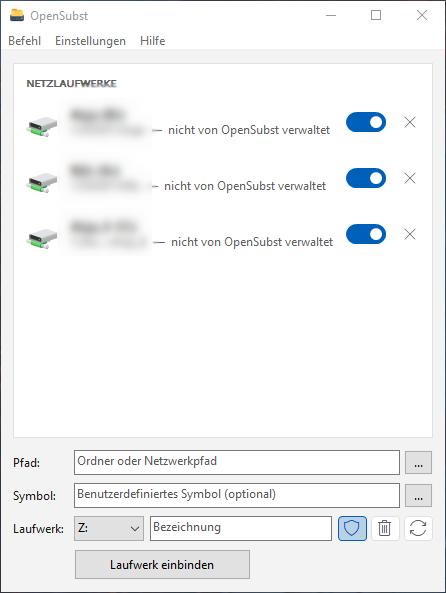

# OpenSubst



Free and open-source virtual drive manager for Windows, written in plain C (Win32 API, no
frameworks, no runtime dependencies). It maps folders and network shares to drive letters,
like `SUBST` and `NET USE`, and adds what those commands lack:

- **Editable drive labels and custom drive icons** shown in Explorer
- **UAC drives**: the same drive also exists for elevated (administrator) applications,
  without a UAC prompt each time
- **Recycle Bin** on virtual and network drives
- **Auto-Restore**: drives come back after a restart, a logoff, a USB stick being plugged in
  again, or a network share becoming reachable again
- **Network drives** managed in the same list, connected in the background
- **Long paths**: targets longer than 260 characters (SUBST.EXE cannot even list or remove those)

OpenSubst offers the same feature set as NTWind Visual Subst 6.1 - without the restrictions of
its unregistered version (which only allows the Documents, Pictures and Videos folders), without
licence keys and without online checks. It is a clean-room implementation: no code, resources or
translations of Visual Subst are used.

## Features at a glance

| Area | What OpenSubst does |
|---|---|
| Drive list | grouped into *Virtual drives* / *Network drives* (optional), toggle switch to enable/disable, remove button, double-click opens the drive, context menu |
| Editor | folder or UNC path (browse, drag & drop), custom icon (`file,index`, icon picker), drive letter, label, toggles for UAC / Recycle Bin / Auto-Restore |
| Commands | Refresh (F5), Enable all, Disable all, Remove all, Register/Unregister UAC task |
| Settings menu | *Operation:* create drives at Windows startup, run in background, tray icon (forced on, greyed out, in background mode) - *Drives:* manage network drives, show only OpenSubst drives, group by type - *Appearance:* language (English, German, external `.lng` files), theme Auto / Light / Dark, always on top |
| Tray | show/hide, enable/disable every stored drive, exit. *Tray icon* only adds the icon; *background mode* also keeps OpenSubst running when the window is closed and starts it hidden in the tray |
| Safety prompts | Restore saved drives?, Apply changes?, Remove all?, Keep running for Auto-Restore?, Enable background mode?, removing drives OpenSubst did not create |
| First run | offers three test drives for Documents, Pictures and Videos |
| DPI | per-monitor DPI aware (v2) |

Drives created elsewhere (with `subst`, `net use` or Explorer) are shown too and can be adopted
("Manage with OpenSubst") or removed.

## Command line

```
OpenSubst [drive1: [drive2:]path] [label] [options]
OpenSubst drive1: /D
OpenSubst /LIST
```

| Switch | Meaning |
|---|---|
| `/ICON location` | custom icon, e.g. `"C:\Icons\Drive.ico,0"` |
| `/UAC`, `/NOUAC` | also create the drive for elevated applications (needs the UAC task) |
| `/RECYCLEBIN` | create a Recycle Bin on the drive |
| `/AUTORESTORE` | re-mount the drive automatically |
| `/NOSAVE` | do not store the drive (with `/D`: only unmount, keep it stored) |
| `/NOCREATE` | only store the drive, do not mount it now |
| `/D` | remove the drive |
| `/LIST` | list all virtual and network drives |
| `/STARTUP` | restore stored drives (used by the autostart entry) |
| `/NOWELCOME`, `/NOMSG` | no welcome message / no messages at all |
| `/REGTASK`, `/UNREGTASK` | register or remove the UAC task (asks for elevation) |
| `/EXPORTLANG file` | write an English language template |

Examples:

```
OpenSubst P: "C:\Projects" Projects /ICON "C:\Icons\Drive.ico"
OpenSubst N: \\server\share Share /AUTORESTORE
OpenSubst P: /D
```

Messages are printed to the console when OpenSubst is started from one, otherwise shown as
message boxes. The exit code is 0 on success and 1 on failure. A running OpenSubst window
picks up command-line changes immediately.

## How it works

**Virtual drives** are DOS device definitions in the user's logon session, exactly what
`SUBST.EXE` creates, but defined with a raw NT target:
`DefineDosDevice(DDD_RAW_TARGET_PATH, "P:", "\??\C:\Projects")`. That is what makes paths longer
than `MAX_PATH` work. No administrator rights are needed.

**Network drives** use `WNetAddConnection3` / `WNetCancelConnection2` on a worker thread, so a
slow or unreachable server never blocks the window. Windows' credential prompt appears when a
share needs it.

**Labels and icons** are per-user Explorer overrides:
`HKCU\Software\Classes\Applications\Explorer.exe\Drives\<X>\DefaultLabel` and `DefaultIcon`,
plus `...\Explorer\MountPoints2\##server#share\_LabelFromReg` for shares. They are written when a
drive is mounted and removed when it is unmounted, so a USB stick that later gets the same letter
keeps its own name. A share label that existed before is backed up and restored.

**UAC drives.** With UAC an administrator works in two logon sessions - the filtered desktop
session and the elevated one - and each has its own drive letters. That is why a normal
`subst` drive is invisible in an elevated command prompt. OpenSubst registers a scheduled task
`\OpenSubstUAC` (once, one UAC prompt) that runs `OpenSubst.exe /UACTASK <payload>` with the
highest available rights and can be started by the user without a prompt. Every drive change
for a UAC drive is then repeated in the elevated session through that task. The payload is
hex-encoded UTF-8, so it cannot inject command-line syntax, and the elevated side validates
every operation again: it never touches the system drive, never replaces a real volume, only
removes drives that are virtual/network drives, and only accepts absolute folder paths or UNC
paths. Results come back through a named shared-memory block and an event, so failures are
reported in the window.

Because the task runs OpenSubst elevated without a prompt, it is only registered when
`OpenSubst.exe`, its folder and the parent folder cannot be changed by standard users (checked
with `AccessCheck` against the user's filtered token) - e.g. `C:\Program Files\OpenSubst`.
In a user-writable folder any program could otherwise replace the exe or plant a DLL and gain
administrator rights through the task. A task left over from such a folder is never used, and
OpenSubst offers to remove it.

**Recycle Bin.** Explorer only gives a drive its own Recycle Bin if the drive root is a known
folder listed under `BitBucket\KnownFolder`. OpenSubst registers one known folder per letter
(`HKLM\...\Explorer\FolderDescriptions\{guid}`, in the 64- *and* 32-bit registry view, so the
bin also works in 32-bit programs - no separate 32-bit helper exe is needed), plus the per-user
parts (`User Shell Folders`, `BitBucket\KnownFolder\{guid}` with 5 % of the volume as capacity).
The HKLM part needs administrator rights once per letter; it goes through the UAC task, or one
UAC prompt if the task is not registered. Deleted files go to `X:\$RECYCLE.BIN`, i.e. a hidden
folder inside the target folder.

**Auto-Restore** checks every 5 seconds (and immediately on device arrival) whether a drive with
Auto-Restore is missing. Virtual drives are re-created as soon as the target folder exists;
network drives are retried every 30 seconds in the background. This needs OpenSubst running
(background mode); the app asks to enable it when you switch Auto-Restore on.

**Autostart** is the `HKCU\Software\Microsoft\Windows\CurrentVersion\Run` value `OpenSubst`
(`"OpenSubst.exe" /startup`). In `/startup` mode OpenSubst restores all enabled drives silently
and either stays in the tray (background mode) or exits once network drives are done.

### Stored data

```
HKCU\Software\OpenSubst
    Flags, Theme, DriveFlags (defaults for new drives), Language, WinLeft/Top/Right/Bottom
HKCU\Software\OpenSubst\Drives\<X>
    Path, Label, Icon (REG_SZ), Flags (REG_DWORD: 1 enabled, 2 UAC, 4 Recycle Bin,
                                      8 Auto-Restore, 16 network drive)
```

OpenSubst is portable: it needs no installer and keeps nothing outside the registry keys above
(plus the Explorer, Run and Task Scheduler entries described in this section).

## Languages

English and German are built in; *View > Language > Automatic* follows the Windows display
language. Further languages are UTF-8 text files in `<OpenSubst folder>\lang\*.lng`:

```
Language=Français
Base=en
BTN_MOUNT=Monter le lecteur
...
```

*View > Language > Export Language Template* (or `/EXPORTLANG file`) writes every key with its
English text. Missing keys fall back to the `Base` language. The keys are listed in
[`src/strings.h`](src/strings.h).

## Building

Requirements: Visual Studio 2019/2022 (Build Tools are enough) with the Windows 10/11 SDK.

```
build.bat          x64   -> bin\x64\OpenSubst.exe
build.bat x86      32-bit
build.bat arm64    ARM64 (needs the ARM64 build tools)
```

The build uses `/W4 /WX /sdl /guard:cf`, links with `/HIGHENTROPYVA /CETCOMPAT`, delay-loads
every DLL that is not a KnownDLL (so none can be planted next to the exe) and links the CRT
statically; the result is a single
exe of about 300 KB. `tools/make_icon.py` (Pillow) regenerates `res/app.ico`.

### Source layout

| File | Purpose |
|---|---|
| `src/main.c` | entry point, command line, token/elevation detection |
| `src/ui.c` | main window, owner-drawn drive list, editor, menus, tray |
| `src/engine.c` | mount/unmount logic, background network connections, Auto-Restore |
| `src/drives.c` | DOS device, WNet and Explorer label/icon primitives |
| `src/uac.c` | Task Scheduler 2.0 (COM, plain C) and the elevated operation protocol |
| `src/recycle.c` | known-folder Recycle Bin registration |
| `src/settings.c` | registry persistence, autostart |
| `src/lang.c`, `src/strings.h` | built-in strings and `.lng` loader |
| `src/theme.c` | Light/Dark, dark menu bar and buttons |
| `src/gfx.c` | anti-aliased shapes via the GDI+ flat API |

## Requirements

Windows 7 SP1 or later (Windows 10/11 recommended; dark mode needs Windows 10 1809+). UAC drives need an administrator account with UAC enabled; the Recycle
Bin needs an administrator account. Standard users can use everything else.

## Licence

MIT - see [LICENSE](LICENSE).
